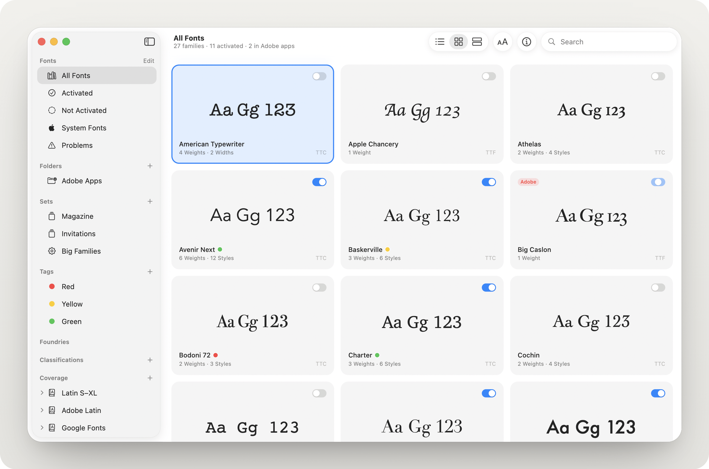

# Cicero

**[Download the latest version](https://github.com/opr-inzn/cicero/releases/latest/download/Cicero.dmg)** · [Help](help/README.md) · [All versions and release notes](https://github.com/opr-inzn/cicero/releases) · [Roadmap](docs/ROADMAP.md) · Requires macOS 15 or later on Apple silicon.

A font manager for macOS. Browse every font on your Mac and in your font folders, try them out, and turn them on only when you need them.

- **Three ways to browse.** A sortable list with an on/off switch for each family, a preview in the font itself, the color of its tag, and columns you can show or hide (classification, foundry, year, rating, Latin S–XL, Adobe Latin and Google Fonts coverage, any Unicode block or coverage set of your own, date added, format). A grid of tiles. Or full-width specimens with every style set in itself.
- **Quick Look.** Press Space, or choose Fonts → Quick Look (⌘Y), for a floating preview of the selected family: a large sample, its styles, and its foundry, format and status. The arrow keys move through the list and the preview follows; with several families selected, ‹ and › step through them.
- **Font pages** (double-click, ↩ or ⌘↓). A large text you can type into, aligned left, center or right, a table of styles you can switch on one by one when a family has more than one, and a searchable glyph map grouped by kind, as a type designer would list it (uppercase, accents, figures, punctuation and so on), with the glyphs features like tabular figures draw, alternates like small capitals next to the characters they’re for, and the ligatures each style makes. Click a glyph for its name, Unicode code and HTML entity, and copy it from there or its right-click menu, as a character or as a vector to edit in a design app, or drag it out of the page, into a design app or the Finder as an SVG file. Right-click the text or a style to give the family a tag or a rating, add it to a set or change its classification.
- **Info and Features.** The info panel shows a font’s details (its designer, vendor ID and embedding permission among them), its tags and rating, your note on it, the languages it supports, its coverage and the Unicode blocks it covers; the Features tab turns OpenType features on in the text on the family’s font page.
- **Search** by family or style name, foundry, PostScript name, designer, vendor ID or your note, or by what a family is: variable, mono, italic, serif, sans, script, display or text, condensed or extended, a tag. Words combine, so “variable sans” finds the variable sans serifs.
- **Names in your language.** A family whose fonts name it in your Mac’s language, as many Japanese, Chinese and Korean fonts do, shows and sorts by that name: Hiragino Sans is ヒラギノ角ゴシック on a Mac in Japanese.
- **Similar fonts.** Right-click a family and choose Show Similar Fonts to see the 12 in your library that look most like it, the closest first, measured from the shapes of their letters on your Mac (x-height, weight, contrast and stress, width and spacing, slant, serifs, aperture, and the a’s and g’s stories) and looked at by a small model that has learned what letters of a kind look like. A font page shows the six closest. Mark one that doesn’t belong **Not Similar** and it leaves the list, and Cicero reports it to make the lists better.
- **Preview Options.** Preview text, size, weight, tracking, leading and alignment, shared by every view.
- **Light or dark.** Follow macOS, or pick Light or Dark in Settings → General.
- **Customizable sidebar.** Click **Edit** next to Library and every item and group gets a checkbox; uncheck what you don’t want and click **Done**. The same list is in **Settings → Sidebar**, and right-clicking a row offers *Hide from Sidebar*. Drag items into the order you like within their section, as in the Finder, and ⌘- or ⇧-click several items in a section to drag them together or see all their fonts at once. A click anywhere on a section’s title opens or closes it, and View → Hide Sidebar (⌃⌘S) puts it away.
- **Sets and smart sets.** Group fonts by hand, whole families or single styles, or with rules that keep a set current: name, foundry, designer, classification, tag, rating, note or whether there is one, set, folder, status, kind, format, number of styles, OpenType feature, embedding, language, coverage or date added. Turn every font in a set on or off from its sidebar menu. Browse by foundry or by classification, which Cicero reads from the fonts themselves and the shapes of their letters (with Apple Intelligence on macOS 26, it recognizes the rest from their names, on your Mac), or make classifications of your own.
- **Tags.** Give a family as many tags as you like, from its right-click menu (on its font page too), the Info panel, or by dropping it on a tag in the sidebar. Cicero comes with tags for license statuses (Licensed, Unlicensed, Open Source and Trial) that you can rename or delete, and you can make your own. Tags show as colored dots next to a family’s name, and every tag has its own sidebar item.
- **Ratings.** Give a family one to five stars from its right-click menu (on its font page too) or the Info panel, see them in the list’s Rating column, and keep your favorites together with a smart set.
- **Notes.** Write a note on a family in the Info panel, like where its license is or which client it’s for, find it by searching, and keep families with notes together with a smart set.
- **Coverage.** See which fonts have every character of Latin S–XL, Adobe Latin 1–5, Google Fonts’ Latin, Cyrillic and Greek sets, a Unicode block (Latin-1 Supplement, Latin Extended-A and -B, Greek, Cyrillic and more), or a coverage set you define yourself.
- **Character Toolbox** (⌥⌘T). Paste any text to find the fonts that have every character, or pick one of 780 languages to see which fonts support it.
- **Compare** (⌥⌘C). Fonts stacked on a shared baseline or drawn over each other, each in the style you pick, a family’s styles against each other too, added from anywhere in your library.
- **Problems.** Finds fonts installed twice, missing and damaged files, fonts on external disks, and duplicates, with a fix for each; none of them removes the only copy of a style. Fonts whose named styles share a PostScript name with another font are listed too, as a minor note.
- **Fonts in a document.** Choose File → Find Fonts in Document, or drop a PDF, IDML, InDesign, Illustrator or Photoshop file on the window, to see which fonts it uses: on, in your library but off, or missing. Turn them all on at once, make a set named after the document, or find a missing font's file on your Mac with Spotlight.
- **Fonts for documents in Adobe apps.** Turn on *Activate the fonts documents use in Adobe apps* in Settings → General, and when a document you open in InDesign, Illustrator or Photoshop uses fonts from your library that are off, Cicero turns them on, with no plugin to install, and off again when the app quits. macOS asks once whether Cicero may control each app; Cicero only asks the app which fonts its documents use.
- **Add fonts.** Open font files from the Finder (Open With → Cicero), drop files or folders on the window, or choose File → Add Fonts (⌘O). Single files are listed where they are, under Added Fonts, without being activated, and read again when they change; when you activate fonts by copying or moving, they’re installed into your Fonts folder instead. A file with fonts your library has already, like a newer version of one you installed, can be skipped, added as another copy or used in place of the one you have: Cicero asks, family by family, showing both versions, or does what you chose in Settings → General, keeping the newer version among the choices.
- **Watched folders.** Fonts in your folders are listed without being activated. The fonts installed for Adobe apps, where type designers put fonts to test them (Adobe’s Fonts folder, and an app’s own like InDesign’s), are listed together under Testing and tagged Testing (a switch in Settings → General hides them). Adobe Fonts from Creative Cloud are listed under Adobe Fonts and tagged Adobe Fonts, with Manage in Adobe Fonts on their font page, which opens the family’s page on the Adobe Fonts website (another switch hides them). They show as active in those apps instead of not activated, and so can a folder of your own that an app loads; their switch turns them on in every app, using the file where it is, or off everywhere.
- **System Fonts.** The fonts that ship with macOS have their own item, and you can keep them out of your other lists with *Show system fonts* in Settings → General.
- **Application sets.** Give a set one or more apps, and Cicero activates its fonts while one of them is open and deactivates them when it quits. Fonts you turned on yourself stay on. Cicero has to be open for this, so it can open when you log in.
- **Temporary activation.** Turn a font on just until Cicero quits, from the Fonts menu (Activate Temporarily, ⌥⌘↩), a font’s right-click menu, or a single style. Nothing is copied, and Cicero turns the font off again on its way out.
- **A question before many.** Every app lists the fonts that are on in its font menu, so turning on more than 100 families at once asks first (a switch in Settings → General stops it).
- **Font Library.** Turn on *Install fonts into Cicero’s Font Library* in Settings → General, and the fonts Cicero installs go into a folder of its own, `~/Cicero/Font Library` (or wherever you move it with **Change**), a folder for each family, and macOS uses them from there. Turning one off leaves it in the library, listed and off, rather than moving it out; **Move Them** brings in the ones Cicero installed in your Fonts folder before.
- **Deactivating never loses a font.** A file in your Fonts folder goes to the Trash only when Cicero installed it as a copy and the original is still there, in your library. Any other file there moves to Cicero’s Deactivated folder, which stays in your library. Fonts used where they are, and those in the Font Library, just turn off.
- **Font cache tools.** Clear the macOS font caches for your account or for all users, plus the caches Adobe apps and Microsoft Office keep (they go to the Trash and are rebuilt on next launch; a restart may be needed), and rebuild Cicero’s font list, from the Fonts menu or Settings → General.
- **Move to Trash** removes a font’s files, including copies in other folders; fonts that come with macOS or an app are never touched.
- **Reveal in Finder** from a font’s right-click menu, a style, ⇧⌘R, or the info panel.
- **Export fonts.** Copy the files of the selected families, or of everything in the list when none are selected, into a folder or a ZIP archive with a subfolder per family, for sending them to someone or a printer (File → Export Fonts, ⇧⌘E). Sets, smart sets, folders, foundries, classifications and character sets also have Export Fonts in their sidebar menu. Fonts that come with macOS or an app are left out.
- **Font list.** Save the selected or listed families as a CSV file for a spreadsheet, a row each with its styles, foundry, designer, version, year, format, classification, status, tags, rating, note and files (File → Export Font List, or a sidebar item’s menu).
- **Back up and restore.** Save your sets, smart sets, tags, ratings, notes, coverage sets, folders, added fonts, foundry names and sidebar, the fonts Cicero turned on, and its settings for activation, system fonts, fonts from Creative Cloud and fonts installed for Adobe apps, with your font files if you like, as one `.cicerobackup` file, and restore it on this Mac or another (File → Back Up Library and Restore Library). Appearance and preview settings stay with each Mac. Each font goes back where it was unless a file is already there; nothing is ever written over.
- **Import from FontExplorer X and Font Book.** Bring over FontExplorer X Pro’s Font Library, sets (in their folders), application sets, smart sets, labels (as tags), ratings, comments (as notes) and activations, and turn on again the fonts that were on, from its library on your Mac or a backup of it (File → Import from FontExplorer X). Or bring Font Book’s collections over as sets (File → Import from Font Book). Cicero opens a copy of FontExplorer X’s database, so nothing of it changes.
- **Updates.** Cicero checks GitHub for new versions and offers to install them. Check now with Cicero → Check for Updates, or turn off *Check for updates automatically* in Settings → General.
- **Moves itself to Applications.** Opened from the disk image or your Downloads folder, Cicero offers to move itself to the Applications folder, where application sets, opening at login and updates work.
- **Help.** A [user guide](help/README.md), opened from Help → Cicero Help, with Release Notes and Report an Issue next to it in the Help menu.

## Help wanted: fonts beyond Latin

Cicero has mostly been tried with Latin fonts, and a lot of it still assumes them. Family names in your Mac’s language, the Cyrillic and Greek coverage sets and the 780 languages of the Character Toolbox reach further. But the samples the previews start with are Latin, the glyph map puts the letters of every other script into one group, and the classifications Cicero reads from the shapes of letters only measure Latin ones.

If you work with Arabic, Hebrew, Devanagari, Thai, Chinese, Japanese, Korean or any other script, your help would be very welcome. Try Cicero with your fonts and [open an issue](https://github.com/opr-inzn/cicero/issues/new) for anything that looks wrong or is missing: a preview that shows the wrong script, text that runs the wrong way, glyphs grouped in a way that makes no sense for your script, or a coverage set you’d need. Sample fonts, sample texts and pull requests are welcome too.

## Roadmap

Coming next: **better similar lists**, from a letter model trained on more families and judged on fonts it has never seen, then **similar styles**, Show Similar Fonts for a single style, so that an italic finds italics and a condensed style condensed ones. How they could work, and what’s still open, is in the [roadmap](docs/ROADMAP.md).

## Privacy

Cicero has no accounts and no ads, and everything it knows about your fonts stays in local files on your Mac, but for the families you mark not similar, which it reports while usage statistics are on. It goes online for three things, and you can turn them off in Settings → General:

- **Usage statistics.** Each time Cicero opens, it sends [TelemetryDeck](https://telemetrydeck.com) its version, the macOS version and a hashed random number that stands for your Mac, to count how many people use Cicero; the first time, it also says your Mac is new. That’s all it sends; the code is in [UsageStatistics.swift](Sources/Cicero/App/UsageStatistics.swift). Turn it off with Share usage statistics.
- **Not-similar reports.** When you mark a family not similar to the one it was listed for, Cicero sends its website that list's family names and the numbers it measured from their letters, with its version, the macOS version and a hashed random number that stands for your Mac, to improve similar fonts. No font files, no pictures of letters. The code is in [SimilarReports.swift](Sources/Cicero/App/SimilarReports.swift). Share usage statistics turns these off too, and your marks then stay on your Mac.
- **Updates.** Each time Cicero opens, and once a day while it stays open, it checks GitHub for a new version. Turn it off with Check for updates automatically.

Classifications Cicero recognizes, from the shapes of the letters or, on macOS 26, with Apple Intelligence from the names, are worked out on your Mac too. The Help menu opens web pages in your browser.

## Credits

- Language data: [Hyperglot](https://github.com/rosettatype/hyperglot) by Rosetta, Apache License 2.0.
- Character sets: [Latin S–XL](https://github.com/koeberlin/Latin-Character-Sets) by Christoph Koeberlin (MIT), [Adobe Latin](https://github.com/adobe-type-tools/adobe-latin-charsets) by Adobe (MIT), the [Google Fonts glyph sets](https://github.com/googlefonts/glyphsets) (Apache License 2.0), and Unicode block data from the [Unicode Character Database](https://www.unicode.org/ucd/) (Unicode License V3).
- Updates: [Sparkle](https://sparkle-project.org).
- Design and functionality inspired by [Typecase](https://typecase.app/) and [Pica](https://pica.joshpuckett.me/).

Cicero is released under the [MIT License](LICENSE). The bundled data keeps its own licenses, included in the app: Hyperglot’s in [Languages-LICENSE.txt](Resources/Languages-LICENSE.txt), and the character set sources’ (MIT, Apache License 2.0 and Unicode License V3) in [CharacterSets-LICENSES.txt](Resources/CharacterSets-LICENSES.txt). Sparkle comes with its own license.
